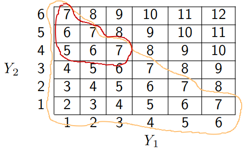
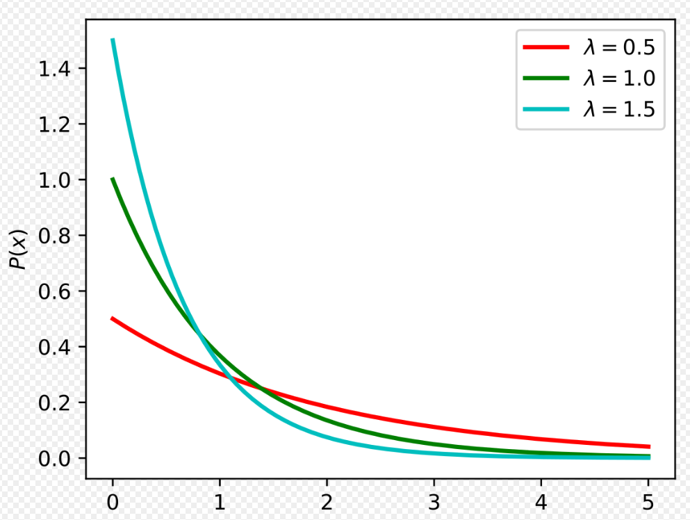
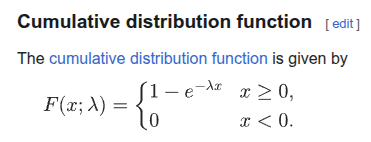

## 1

Suppose you toss a fair coin 10 times, and random variable `X` is the number of heads in total.  
What's the mathematical expectation of `X`? (Please enter a numerical value only.)

$E(X) = n*p$, gives us `5`.

## 2

What is the variance of `X`? (Please enter a numerical value only.)

$Var(X) = n*p*(1 - p)$, gives us `2.5` 

## 3
Suppose you toss two fair 6-face dice, and you get $Y_1$ and $Y_2$.
Let $X = Y_1 + Y_2$. Find the conditional probability $P[Y_2 \ge 4 \mid X \le 7]$.
Round your answer to 3 decimal places. (Please enter a numerical value only.)

$6 / 21 \approx 0.286$

## 4
Suppose continuous random variable $X$ follows exponential distribution with parameter $λ = 1$, i.e., 
$X∼e$. Which is the correct answer for conditional probability $P[X \ge 3 \mid X \ge 1]$?

Looking at the Density Function graph we want to compute area from $x = 1$, compute area from $x = 3$,
then divide on another like we did in **3**.

That gives us:
$$
\frac{1 - (1 - e^{-3})}{1 - (1 - e^{-1})} = \frac{e^{-3}}{e^{-1}} = e^{-2}
$$

## 5 
Suppose continuous random variable X follows a normal distribution with mean 2 and variance 4, i.e. 
$X∼N(2,4)$. What is the mathematical expectation of $e^X$? Round your answer to 1 decimal. (Please enter a numerical value only.)

Use `Moment generating function` to solve this easily. 